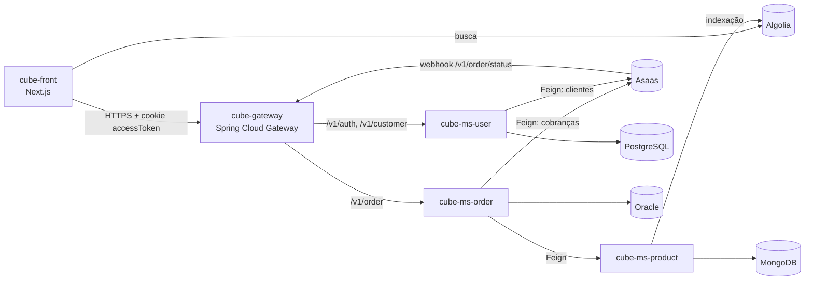

# cube-ms-product

Microsserviço de **catálogo de produtos** do **Cube**. Guarda os produtos no MongoDB, mantém o índice de busca do **Algolia** sincronizado e fornece ao serviço de pedidos os dados e preços dos itens do carrinho.

## Ecossistema Cube



Todos os serviços e o gateway se registram no **cube-ms-eureka**.

| Repositório | Papel | Stack |
| --- | --- | --- |
| [cube-front](https://github.com/MatheysJ/cube-front) | Loja (interface web) | Next.js, Chakra UI, Algolia |
| [cube-gateway](https://github.com/MatheysJ/cube-gateway) | API Gateway e autenticação JWT | Spring Cloud Gateway |
| [cube-ms-eureka](https://github.com/MatheysJ/cube-ms-eureka) | Descoberta de serviços | Netflix Eureka Server |
| [cube-ms-user](https://github.com/MatheysJ/cube-ms-user) | Usuários e login | Spring Boot, PostgreSQL |
| **cube-ms-product** (este repositório) | Catálogo de produtos | Spring Boot, MongoDB, Algolia |
| [cube-ms-order](https://github.com/MatheysJ/cube-ms-order) | Pedidos e pagamentos | Spring Boot, Oracle, Asaas |
| [cube-admin](https://github.com/MatheysJ/cube-admin) | Painel administrativo (em planejamento) | - |

## Funcionalidades

- CRUD de produtos persistido no **MongoDB** (`product_db`).
- **Sincronização com o Algolia**: ao criar, editar ou remover um produto, o índice `products_index` é atualizado. É a busca que o front consome diretamente. Falhas no Algolia são registradas em log e não derrubam a operação no banco.
- **Consulta em lote por ids** (`POST /v1/product/list`), usada pelo `cube-ms-order` (via OpenFeign) para obter nome, imagem e preço atual dos itens na hora de montar o pedido.
- Validação de entrada com Bean Validation e respostas de erro padronizadas.

## Modelo do produto

| Campo | Descrição |
| --- | --- |
| `id` | Identificador (MongoDB) |
| `name`, `summary`, `description` | Nome, resumo e descrição |
| `image` | Imagem do produto |
| `categoryId` | Categoria (campo indexado) |
| `price.standard` | Preço padrão (obrigatório) |
| `price.sale` | Preço promocional (opcional) |

## Endpoints

Base: `/v1/product`

| Método | Rota | Descrição |
| --- | --- | --- |
| `GET` | `/v1/product` | Lista todos os produtos |
| `POST` | `/v1/product/list` | Retorna os produtos de uma lista de `{ id, options, quantity }` |
| `POST` | `/v1/product` | Cria um produto (`201`) e o indexa no Algolia |
| `PATCH` | `/v1/product/{id}` | Edita campos do produto e atualiza o índice |
| `DELETE` | `/v1/product/{id}` | Remove o produto (`204`) e o retira do índice |

Exemplo de criação:

```json
{
  "name": "Cubo mágico 3x3",
  "summary": "Clássico de velocidade",
  "description": "Cubo mágico profissional 3x3.",
  "categoryId": "puzzles",
  "image": "https://exemplo.com/cubo.png",
  "price": { "standard": 59.9, "sale": 49.9 }
}
```

Operações com um `id` inexistente retornam erro de requisição inválida com a mensagem "Produto com id informado não existe".

## Tecnologias

- Java 21
- Spring Boot 3.4.5, Spring Web e Bean Validation
- Spring Data MongoDB
- Spring Cloud 2024.0.0 (Eureka Client)
- Algolia Search Client Java 4.5.4
- MapStruct 1.6.3 e Lombok
- Docker Compose (MongoDB para desenvolvimento)

## Variáveis de ambiente

| Variável | Obrigatória | Descrição |
| --- | --- | --- |
| `ALGOLIA_APP_ID` | Sim | Application ID do Algolia |
| `ALGOLIA_API_KEY` | Sim | Chave do Algolia com permissão de escrita no índice |
| `MONGO_USER` | Não | Usuário do MongoDB. Padrão: `root`. Com o `compose.yaml` do repositório, use `admin`. |
| `MONGO_PASSWORD` | Não | Senha do MongoDB. Com o `compose.yaml`, use a senha definida nele. |
| `EUREKA_URL` | Não | URL do Eureka Server |
| `EUREKA_INSTANCE` | Não | Hostname público com que o serviço se registra no Eureka |

O MongoDB é esperado em `localhost:27017`, banco `product_db`.

## Como executar

Pré-requisitos: JDK 21+, Docker, um Eureka Server acessível e uma conta no Algolia. O índice `products_index` é criado automaticamente quando o primeiro produto é salvo.

1. Suba o MongoDB. O `compose.yaml` cria um MongoDB com usuário root `admin`, e o `spring-boot-docker-compose` o inicia automaticamente ao rodar a aplicação (ou suba manualmente com `docker compose up -d`).

2. Defina as variáveis e execute:

   ```bash
   export ALGOLIA_APP_ID="<seu app id>"
   export ALGOLIA_API_KEY="<chave de escrita do Algolia>"
   export MONGO_USER="admin"
   export MONGO_PASSWORD="<senha do compose.yaml>"
   export EUREKA_URL="http://localhost:8761/eureka/"

   ./mvnw spring-boot:run   # no Windows: mvnw.cmd spring-boot:run
   ```

O serviço sobe em `http://localhost:8081`.

## Estrutura

```
src/main/java/com/cube/product
├── controllers/   # ProductController
├── services/      # ProductService
├── clients/       # AlgoliaClient e implementação
├── config/        # Bean do SearchClient (Algolia)
├── documents/     # ProductDocument (MongoDB)
├── repository/    # ProductRepository
├── mappers/       # MapStruct
├── dtos/          # Request, response e internos
└── exceptions/
compose.yaml       # MongoDB para desenvolvimento
```

## Autor

Desenvolvido por [@MatheysJ](https://github.com/MatheysJ).
